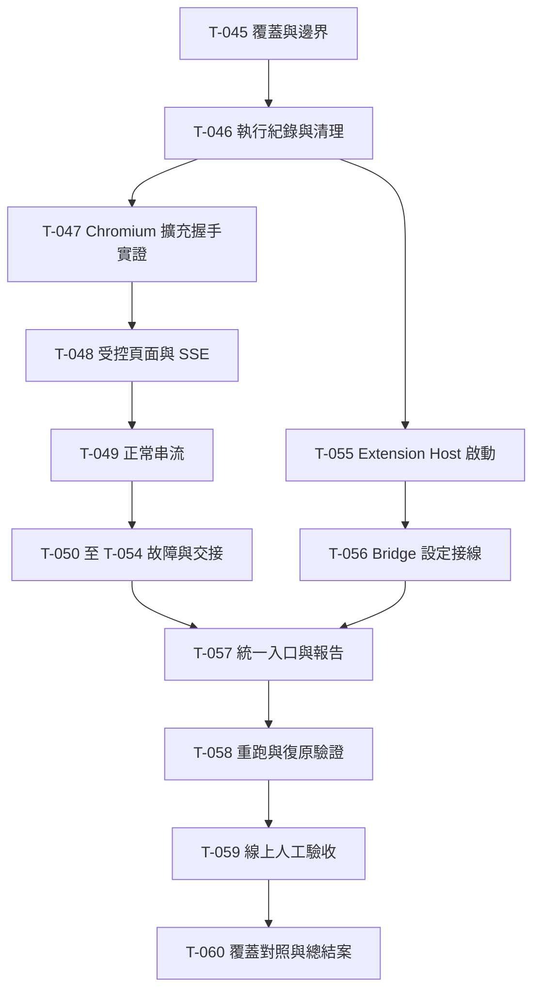

# E2E 可重現驗證與分層驗收規格

建立日期：2026-11-23。使用者已採用分層方案，本輪交付為完整工單，實作尚未開始。

## 1. 目標與範圍

解除自動驗證對 CUA、Canary 擴充安裝 UI、登入及模型回應的共同依賴，同時保留真實 ChatGPT／Canary 的驗收證據。執行入口為 [派工單](../todo.md) T-045～T-060；每張獨立交付 task-report、命令、exit code、證據位置及剩餘限制，不能以工單拆分或 fixture 通過宣稱 T-019 完成。

目前可重用 [Agent 整合測試](../../test/auto-handoff-integration.test.js)、[Bridge 測試](../../test/bridge-partial-response.test.js)、[交接決策](../../src/auto-handoff.js)、[字數估算](../../src/usage.js)。現有測試為部分覆蓋，不以歷史 PASS 計入本系列 fresh evidence。T-045 須量出既有案例覆蓋與缺口，再決定新增範圍。

## 2. 四層驗證

| 層級 | 真實元件 | 受控替代 | 可證明與限制 |
| --- | --- | --- | --- |
| 決策／副作用 | Agent、工具、暫存檔案 | Bridge 輸入與回應 | 閾值、上限、背景抑制、重複寫入；不證明瀏覽器行為 |
| 瀏覽器整合 | Chromium、原始 MV3 擴充、Bridge、必要的 Agent | 頁面 DOM、ChatGPT HTTP／SSE | 真實跨程序傳輸與解析；不證明線上網站相容性 |
| 編輯器整合 | Extension Development Host、擴充啟動與設定接線 | 專用工作區、受控瀏覽器服務 | 設定、Bridge 生命週期與釋放；VS Code 通過不能代表 VSCodium 通過 |
| 線上驗收 | 隔離 Canary、VSCodium、登入 ChatGPT、專用 Project／對話 | 僅測試資料及縮小的 contextWindow | 真實相容性、新舊 ID、Project／tab 歸屬與續作；由 Brian 驗收 |

## 3. 執行與隔離契約

- 優先重用已安裝的 playwright-core、ws 與 Node test runner；瀏覽器需使用與 Playwright 相容的 Chromium。先盤點現有 browser binary，不假設 playwright-core 已附帶瀏覽器；若需下載，固定版本／revision 並記錄來源與安裝方式。禁止自動安裝浮動 latest。
- 測試程式可使用 Playwright 自動化測試，無需 CUA。不得用本方案操控既有正式工作視窗或繞過工具權限；agent 的互動式 UI 操作仍遵循其控制工具規則。
- 測試 profile、workspace、ports 台帳、runlog 全部位於專用暫存根目錄；每輪產生 runId，記錄 PID、啟動時間、profile、工作區、extension version／protocol、browser／Node／editor 版本與 commit。
- Bridge 使用隔離埠，避開正式 8765 與席位、子代理埠；先確認 8799 未占用才使用。若改用動態埠，必須驗證與 8799 同等的顯式 pin 及禁止正式 roster 探索邊界，不得因避衝突而降低隔離。
- 保留原始擴充 manifest 的 chatgpt.com 範圍；受控頁面優先用 browser context routing 攔截專用 context 的 HTTPS 文件／API，禁止真實 auth、conversation API 外送。Service Worker 網路與 WebSocket 須明確區分攔截／允許清單，未命中的外部請求 fail-closed。T-048 必須驗證攔截確實覆蓋 MAIN world fetch，否則停止擴充案例。
- 不改正式 manifest 權限、不停用 TLS 驗證或安全檢查；不得以直接注入腳本冒充 MV3 擴充成功載入。T-047 必須同時取得 service worker、content script hello、Bridge welcome、tab／profile 對應。
- 使用原始 SSE parser 與真實傳輸，禁止測試直接呼叫完成 callback 冒充串流；fixture 清楚標為合成資料，不包含 cookie、token 或私人對話。
- 每個案例在成功、assertion 失敗、timeout、取消時執行 finally 清理；run 級另有回收入口。SIGKILL 無法執行 finally，必須留下 owner manifest 供下次人工／工具核對後復原。不得關閉所有權不明的程序；不得用模糊程序名稱批次 kill。
- 一次可重跑單一 case，不自動重送線上訊息。環境失敗與 assertion 失敗分開報告，缺前置為未執行，不能寫 PASS；重試最多 3 次且須有新診斷／修正，無變化時不重複查 host。

## 4. 驗收案例與證據

| 工單 | 必要觀測與負向檢查 |
| --- | --- |
| T-047 | 原始擴充載入、正確 protocol／pinnedPort 與 hello/welcome；錯 pin 拒絕；無真實登入要求 |
| T-048 | 最小 composer、Project 路徑、新舊 conversation ID 與 backend-api SSE 契約；真實外網請求為零；未匹配 API 明確失敗 |
| T-049 | prompt 經 Bridge 到 DOM，fixture fetch 經 injected/content 回傳；partial、complete、ID 與收到的文字吻合 |
| T-050 | SSE 中斷、明確 abort、WebSocket 斷線各獨立案例；不把 partial 當成功、不自動重送；重現機制不等於歷史線上 AbortSignal 根因 |
| T-051 | autoHandoff 關閉、估算值低於／等於／高於 75% 邊界；到達時新 ID 不同、fresh=true、同 Project、完成兩回合續作；不大量消耗線上 token |
| T-052 | 第二回合重複寫入被阻止且暫存檔雜湊符合預期；maxHandoffs=1 後不再切換；背景 pending 時不切換、結束後重新評估 |
| T-053 | 導航失敗、相同／缺失 ID、錯 Project、錯 tab 分別拒絕；錯誤後未向其他 tab 送 prompt 或執行工具 |
| T-054 | 兩組獨立 context／Bridge 所有權，錯 pin／roster 不流入，關閉其中一組另一組保持；不接觸正式 8765 |
| T-055 | 在專用 Extension Host 啟動原始擴充，記錄 activation 證據；確認 VS Code 與 VSCodium 各自可行性 |
| T-056 | 經正式命令／面板入口建立 Bridge；只在無可測入口時做最小內部抽取，共用正式路徑且不加入 production bypass；8799 設定、listener owner、dispose 釋放均可觀測 |
| T-058 | 至少兩次全新 profile 重跑；指定 case 單跑；失敗／timeout／取消及一次強制終止後復原；fixture 網路零外送與正式工作區不變 |
| T-059 | Brian 在專用登入 profile 執行關閉交接時多回合、啟用後切新 ID、同 Project／tab、交接內容與兩回合續作；保存遮蔽後 log／URL／設定、版本與結果 |

每個案例保存開始／結束時間、輸入、預期／實際、assertion 結果、exit code、必要 screenshot／trace 與遮蔽後 log。敏感 artifact 不進 Git；task-report 連結可移交的證據並說明保存位置與限制。清理後核對 run 的 listener、程序及設定；失敗證據先保留再刪可丟棄 profile。重跑時新 runId，不覆蓋舊證據。

## 5. 舊工單銜接與完成條件

新自動化 T-045～T-058 不依賴 T-029。T-029～T-033 保留原 CUA 路徑的歷史狀態；T-059 提供人工可見操作的另一條線上前置／驗收路徑，需同等 profile、Project、tab、Bridge 所有權證據，不因換路徑放寬驗收。

| 舊要求 | 新證據位置 | 尚需線上驗證 |
| --- | --- | --- |
| E2E-00／T-029～T-033 | T-047、T-054、T-056、T-059 | 登入 Canary／VSCodium 的所有權由 T-059 核對 |
| E2E-01～02／T-034～T-035 | T-051 | 關閉交接多回合由 T-059 確認；75% 為估算值 |
| E2E-03～05／T-036～T-038 | T-051、T-053、T-059 | 真實新對話、Project／tab 與續作由 T-059 確認 |
| E2E-06～08／T-039～T-041 | T-052 | 受控整合替代線上故障／副作用測試，T-060 須明載此範圍變更 |
| E2E-09／T-042 | T-053 | 不在真實帳號注入破壞性故障；以受控整合證據驗收 |
| E2E-10／T-043 | T-050 加既有診斷 | 合成 abort 不能關閉歷史根因；未釐清時留明確限制與獨立診斷追蹤 |
| E2E-11／T-044 | T-046、T-058、T-059 | 線上設定／程序復原在每次驗收當場核對 |

T-060 必須逐列更新舊驗收矩陣，標明原線上標準改由哪種證據驗收，以及 Brian 的人工驗收結果。不得將舊實機未執行列直接改成「實機 PASS」；不得自動關閉 T-043。T-019 結案前須所有必要證據齊備、人工驗收完成、剩餘未達標項目有明確處置；任何未獲接受的缺口存在時，維持保留。

## 6. 工單執行原則與交付

T-045 先完成覆蓋矩陣與執行成本估算；T-047 是最小技術實證，未通過前不投入完整 DOM fixture。每張工單只處理一項能力，失敗時產出原因及下一個可執行入口，獨立分支／PR 依專案交付規則處理。每次接續先讀對應報告與當前 Git／程序狀態，不能從舊 PID 推論程序仍相同。T-057 統一命令、T-058 保證可重跑後，才安排 T-059 給 Brian 驗收。

官方設計依據：[Playwright Chrome extensions](https://playwright.dev/docs/chrome-extensions)、[VS Code Testing Extensions](https://code.visualstudio.com/api/working-with-extensions/testing-extension)。它們支持測試架構選擇，不代表本專案或 VSCodium 已驗證通過。
